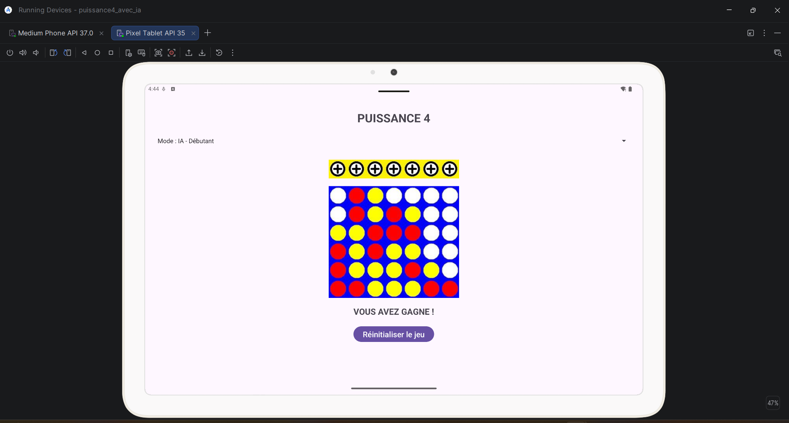

# 🔴🟡 Suite d'Applications Mobile Android : Puissance 4 (Lite & IA)

Bienvenue sur le dépôt officiel du projet **Puissance 4 Native Android**. Ce projet rassemble deux applications distinctes développées en **Java** sous **Android Studio**, permettant d'explorer le développement d'un jeu de plateau mobile puis son enrichissement par des algorithmes d'intelligence artificielle.

---

## 🎮 1. Fonctionnement du Projet 1 : `puissance4_lite` (Mode 2 Joueurs sans IA)

Le premier projet constitue le socle fondamental de l'application. Il s'agit d'une version permettant à deux joueurs humains de s'affronter localement sur le même appareil (smartphone ou tablette).

### Logique et Mécanique de Jeu

* **Grille de jeu (6x7) :** Le plateau est structuré sous forme d'une matrice de **6 lignes et 7 colonnes** (42 emplacements au total). À l'initialisation de la partie, toutes les cases sont libres.
* **Gestion de la Gravité :** En haut du plateau, un alignement de 7 boutons d'action correspond aux 7 colonnes. Lors du clic sur une colonne, le système calcule automatiquement la position disponible la plus basse (simulation de la gravité mécanique) pour y déposer le jeton.
* **Gestion des Tours et Couleurs :**
  * **Joueur 1 :** Pions **Jaunes**
  * **Joueur 2 :** Pions **Rouges**
  
  L'application met à jour l'interface dynamique après chaque coup pour indiquer quel joueur doit jouer.
* **Détection Automatique de Victoire :** Après chaque jeton déposé, le moteur du jeu analyse le plateau dans 4 directions pour détecter un alignement continu de **4 pions identiques** :
  1. **Verticale** (vers le bas)
  2. **Horizontale** (de gauche à droite)
  3. **Diagonale Ascendante**
  4. **Diagonale Descendante**

Lorsqu'un alignement est validé, les interactions sont bloquées et le message de victoire s'affiche.

### Captures d'Écran — Projet Lite


*Exemple d'alignement diagonal à 4 pions validé par le moteur de jeu.*

---

## 🤖 2. Fonctionnement du Projet 2 : `puissance4_ia` (Mode Solo avec IA)

Le second projet conserve la totalité des mécaniques du projet de base, mais intègre un **mode solo** permettant au joueur humain d'affronter l'appareil grâce à différents niveaux d'Intelligence Artificielle.

### Choix du Mode et Comportements de l'IA

L'interface intègre un menu déroulant (`Spinner`) permettant de basculer instantanément entre le mode 2 joueurs et les **3 niveaux d'IA** :

1. **Niveau 1 — Débutant :**
   * **Comportement :** L'IA privilégie un tirage aléatoire des colonnes pour simuler un joueur novice.
   * **Sécurité :** Elle intègre une détection basique de menace directe pour bloquer les victoires immédiates du joueur humain si celui-ci est sur le point d'aligner son 4ᵉ pion.

2. **Niveau 2 — Intermédiaire (Bloqueur Actif) :**
   * **Comportement :** L'IA analyse activement le plateau à chaque tour.
   * **Priorités :**
     1. Tente de placer le 4ᵉ pion pour gagner immédiatement si une opportunité existe.
     2. Détecte les séries de 3 pions du joueur humain (horizontales, verticales ou diagonales) et vient placer un pion pour contrecarrer son alignement.
     3. Privilégie le contrôle des colonnes centrales.

3. **Niveau 3 — Expert (Algorithme Minimax) :**
   * **Comportement :** L'IA anticipe la partie en simulant plusieurs coups à l'avance grâce à l'algorithme d'optimisation **Minimax**.
   * **Stratégie :** Elle évalue la valeur tactique de la grille à chaque coup potentiel, construit des pièges complexes (alignements multiples) et ne commet aucune erreur tactique directe.

### Captures d'Écran — Projet IA


*Affichage du menu déroulant et partie en cours contre l'Intelligence Artificielle.*

---

## 📂 3. Arborescence du Répertoire Global

Voici la structure exacte des fichiers et dossiers que vous trouverez dans ce dépôt GitHub :

```text
.
├── README.md                           # Documentation globale du projet
├── screenshots/                        # Captures d'écran d'illustration
│   ├── image_22b0a1.png
│   ├── image_22ace0.png
│   ├── image_231d02.png
│   └── image_206ee1.png
│
├── puissance4_lite/                    # PROJET 1 : Version sans IA (2 Joueurs)
│   ├── build.gradle
│   ├── settings.gradle
│   └── app/
│       └── src/
│           └── main/
│               ├── AndroidManifest.xml
│               ├── java/
│               │   └── com/example/puissance4_lite/
│               │       └── MainActivity.java       # Logique de jeu (grille, gravité, victoires)
│               └── res/
│                   ├── layout/
│                   │   └── activity_main.xml       # UI (GridLayout 6x7 + boutons)
│                   └── drawable/                   # Assets (pions jaunes, rouges, cases vides)
│
└── puissance4_ia/                      # PROJET 2 : Version avec IA
    ├── build.gradle
    ├── settings.gradle
    └── app/
        └── src/
            └── main/
                ├── AndroidManifest.xml
                ├── java/
                │   └── com/example/puissance4_ia/
                │       └── MainActivity.java       # Logique du jeu + Algorithmes IA (Minimax, Bloqueur)
                └── res/
                    ├── layout/
                    │   └── activity_main.xml       # UI avec Spinner de niveau d'IA
                    └── drawable/
```

---

## 🛠️ Guide d'Installation et d'Exécution

1. **Cloner le dépôt :**
   ```bash
   git clone https://github.com/votre-nom-utilisateur/puissance4.git
   ```

2. **Ouvrir sous Android Studio :**
   * Pour tester la version classique : Ouvrez le dossier `puissance4_lite`.
   * Pour tester la version avec IA : Ouvrez le dossier `puissance4_ia`.

3. **Compiler et Exécuter :**
   * Lancez l'émulateur Android (AVD) ou connectez un appareil réel via le débogage USB.
   * Cliquez sur le bouton **Run (Shift + F10)**.
